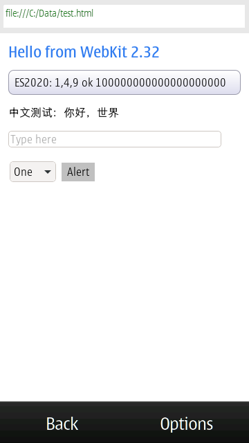
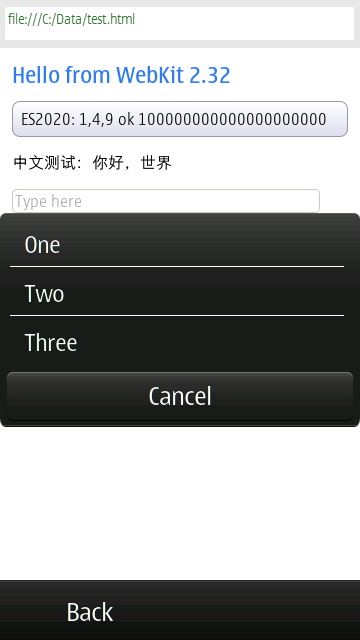

# WebKit for Symbian^3

The `2.32.4-symbian` branch is a port of WebKit 2.32.4 to Symbian^3 (S60 5.2 and later, ARM11 / ARMv6, EKA2): JavaScriptCore with an ARMv6 JIT, WebCore (`PORT=Symbian`), a WebKitLegacy WebView and an AVKON browser.

The port is a series of commits on top of WebKit's webkitgtk/2.32 tip `a81ec020`; `git log a81ec020..` lists them. Port changes go straight into the WebKit sources on this branch. This directory holds what builds and packages it:

| Path | |
| --- | --- |
| `build.sh` | runs every step below |
| `scripts/` | build steps, the E32 header tool, the SIS writer |
| `toolchain/` | compiler wrappers and the CMake toolchain for WebKit's own build |
| `e32/` | the link project for `jsc.exe` |
| `browser/` | the AVKON browser shell (`browser.exe`) |
| `shims/` | small replacements for what the SDK's libraries lack |
| `patches/` | patches to other projects: the symbian-platform E32 converter, ICU 63.2, EKA2L1 |
| `tests/` | ES2020 and Intl test scripts |
| `qemu/` | Linux ARMv6 build and differential tests under qemu-arm (ARM1136) |
| `eka2l1/` | scripts that run `jsc.exe` and `browser.exe` in EKA2L1 |
| `../../.github/workflows/symbian.yml` | CI: builds the SIS packages on every push |

Toolchain: the [symbian-platform](https://github.com/hpnkv/symbian-platform) 0.3.0 SDK (clang, the Open C + libc++ runtime, and `symbian-native` to convert ELF to E32).

## Building

Prerequisites:

* an installed symbian-platform 0.3.0 SDK (`symbian sdk install`, or its release tarball)
* host tools: `clang`, `lld`, `cmake`, `ninja`, `ruby`, `perl`, `gperf`, `flex`, `bison`, `unifdef`, `python3`, `pkg-config`, autotools

A checkout needs only part of WebKit:

```sh
git clone --filter=blob:none --no-checkout -b 2.32.4-symbian https://github.com/yeatse/webkit-symbian
cd webkit-symbian
git sparse-checkout set PerformanceTests Source/JavaScriptCore Source/ThirdParty/capstone Source/WTF \
  Source/WebCore Source/WebKitLegacy Source/bmalloc Source/cmake Tools/Scripts Tools/Symbian
git checkout 2.32.4-symbian
```

Then:

```sh
export SYMBIAN_SDK_PREFIX=/path/to/symbian-sdk
Tools/Symbian/build.sh          # everything, into WebKitBuild/Symbian
Tools/Symbian/build.sh jsc      # jsc.exe only
```

Each step can also run alone, in this order:

```sh
Tools/Symbian/scripts/build-symbian-native.sh  # the E32 converter, with patches/symbian-native
Tools/Symbian/scripts/build-icu.sh             # ICU 63.2 and its trimmed data file
Tools/Symbian/scripts/build-jsc.sh             # JSCOnly: static JavaScriptCore and the jsc shell
Tools/Symbian/scripts/link-e32.sh              # jsc.exe
Tools/Symbian/scripts/build-deps.sh            # pixman, cairo, … curl for WebCore
Tools/Symbian/scripts/build-webcore.sh         # PORT=Symbian: static WTF, JavaScriptCore, PAL, WebCore, WebKitLegacy
Tools/Symbian/scripts/link-webcore.sh          # optional: prints any undefined symbols (none) and the size
Tools/Symbian/scripts/build-browser.sh         # browser.exe and its .rsc files
Tools/Symbian/scripts/package-sis.sh           # the SIS packages
```

Outputs, under `WebKitBuild/Symbian` (`SYMBIAN_WEBKIT_WORK` moves it):

* `build/e32/e32/jsc.exe`
* `build/browser/e32/browser.exe`, `browser_reg.rsc`, `browser_loc.rsc`
* `icu/install/share/icu/icudt63l.dat`, which goes in `C:\resource\icu\` on the phone
* `sis/symbian-webkit-icu.sis`, `jsc.sis`, `browser.sis`

Options:

* `OPTIMIZE` (default `-Os`)
* `ICU_DATA=file|static`, `ICU_DATA_DIR`, `ICU_LOCALES="en zh …"|all`
* `JSC_HEAP_MIN`, `JSC_HEAP_MAX`, `JSC_STACK`, and `BROWSER_*` likewise
* `STUB=1 scripts/build-browser.sh` builds the shell with a stand-in engine, without WebKit
* `scripts/e32info.py` prints an E32 header

### SIS packages

* `symbian-webkit-icu.sis` holds the ICU data both programs read; install it first.
* `scripts/make-sis.py` writes the packages: the SDK's SISX layout, with compressed files and no size limit. They name Symbian^3/Anna (S60 5.2) and Belle (S60 5.3) as target devices.
* They are unsigned. `SIS_CERTIFICATE` and `SIS_KEY` name a PEM certificate and RSA key to sign them with instead; updating an installed package then needs the certificate it was signed with.
* `SIS_VERSION` sets the package version (default 0.3.0).
* Before installing on a phone, remove files copied there by hand (`C:\sys\bin\jsc.exe`, `browser.exe`, `C:\resource\icu\icudt63l.dat`) and uninstall packages signed with another certificate: the installer will not overwrite files it does not own.

### CI

`.github/workflows/symbian.yml` builds everything on every push to a `*-symbian` branch (and for pull requests to one) and uploads the three packages as the `sis` artifact. A `symbian-vX.Y.Z` tag also attaches them to a release.

* The checkout is sparse and without blobs outside it: only the directories above.
* The SDK comes from symbian-platform's v0.3.0 release (`symbian-sdk-0.3.0-linux-x86_64.tar.gz`).
* The E32 converter, ICU, the WebCore libraries and a ccache are cached between runs; with a warm cache a run takes a few minutes.
* The packages are versioned 0.3.<run number>, so each build installs over the previous one; a `symbian-vX.Y.Z` tag gives version X.Y.Z.
* To sign them, store a PEM certificate and RSA key as the repository secrets `SIS_CERTIFICATE` and `SIS_KEY`.

### Running in EKA2L1

Install the device firmware (for example the Nokia X7-00, RM-707) in EKA2L1 first.

```sh
export EKA2L1=/path/to/eka2l1_qt
Tools/Symbian/eka2l1/run.sh C:/Data/es2020.js                   # prints C:\Data\jsc.log
Tools/Symbian/eka2l1/run.sh --useJIT=false C:/Data/es2020.js    # jsc arguments as usual
Tools/Symbian/eka2l1/run-browser.sh WebKitBuild/Symbian/build/browser/e32/browser.exe "C:/Data/test.html fep-selftest"
```

### Testing the ARMv6 backend under qemu

Needs Ubuntu/Debian's `qemu-user` and `g++-arm-linux-gnueabi`.

```sh
Tools/Symbian/qemu/build.sh                  # a Linux ARMv6 jsc, running tests/ in 4 JIT configurations
git sparse-checkout add JSTests/stress
SAMPLE=4 Tools/Symbian/qemu/run-stress.sh    # differential: LLInt vs early JIT (without / with inline caching)
```

## Working on the port

* Commit changes to WebKit's sources directly on this branch, in WebKit's style. Upstream WebKit changes come in by merging; build tooling stays in `Tools/Symbian`.
* Changes to other projects (the E32 converter, ICU, EKA2L1) stay as patches in `patches/`; the build scripts apply them.

## Why 2.32

ES2020 support in JavaScriptCore, checked on each webkitgtk release branch:

| ES2020 feature | 2.24 | 2.26 | 2.28 | 2.30 | 2.32 |
| --- | --- | --- | --- | --- | --- |
| `?.` optional chaining, `??` nullish coalescing | – | ✓ | ✓ | ✓ | ✓ |
| `Promise.allSettled`, `String.prototype.matchAll` | – | ✓ | ✓ | ✓ | ✓ |
| `globalThis`, `import()`, `import.meta` | ✓ | ✓ | ✓ | ✓ | ✓ |
| `BigInt` on by default (`useBigInt`) | off | off | off | ✓ | ✓ |
| `export * as ns from "m"` | – | – | – | – | ✓ |

**2.32 is the first release with full ES2020.** This branch starts from the webkitgtk/2.32 tip `a81ec020` (2.32.4 plus later security merges, 2021-10).

The catch: the ARMv5/v6 `ARM_TRADITIONAL` JIT backend was removed in 2018-11 (`933424d6d7`). On 32-bit ARM, 2.32 only has ARMv7 Thumb-2 and the C_LOOP interpreter.

## Results

`jsc.exe` (JIT + inline caching, ICU data in a separate file):

| | |
| --- | --- |
| E32 image | 14.2 MB |
| Code section | 14.0 MB |
| Data + BSS | 14 KB + 96 KB |
| Code / data relocations | 99 543 / 487 |
| Imported DLLs | `euser` `hal` `libc` `libm` `libpthread` `drtaeabi` |
| ICU data file `icudt63l.dat` | 9.8 MB (20 languages; 20.5 MB with all) |
| E32 header | heap 1 MB – 128 MB, stack 1 MB |

### In EKA2L1

[EKA2L1](https://github.com/EKA2L1/EKA2L1) with the Nokia X7-00 (RM-707) firmware installed. `Tools/Symbian/eka2l1/run.sh` puts `jsc.exe` in `C:\sys\bin` and the ICU data in `C:\resource\icu`, then starts jsc with a script on the command line.

* In four configurations the output of `tests/es2020.js` and `intl.js` is identical to the LLInt's: LLInt only, Baseline JIT (DFG off), default, and tiering up early (`--jitPolicyScale=0`).
* ICU loads from the file: `Intl.Collator` / `DateTimeFormat` / `NumberFormat` / `PluralRules`, Chinese dates (`1970年1月1日星期四`), yen formatting, and Chinese word segmentation (`我们|是|中国人`). Languages that were trimmed (for example `sw`) are missing from `supportedLocalesOf` and fall back to English when formatting.
* Timings (EKA2L1's dynarmic runs on x86, so only the ratios mean anything, not the absolute speed on a phone):

  | Test | LLInt only | JIT, no inline caching | JIT + inline caching |
  | --- | --- | --- | --- |
  | Integer hot loop (3 million iterations) | 2467 ms | 667 ms | 691 ms |
  | Monomorphic property reads/writes | 2518 ms | 3422 ms | 549 ms |
  | Polymorphic property reads/writes | 10296 ms | 3591 ms | 708 ms |

  Without inline caching, every property access from JIT code calls a C++ slow path, so the monomorphic case is even slower than the LLInt. With it, the JIT is 4.6–14.5 times faster than the LLInt.

Symbian platform-layer problems fixed before it ran in the emulator:

* There is no `/dev/urandom`: WTF's random device uses `Math::Random()` instead (backed by the kernel's secure generator since S^3).
* The explicit `std::__sort` instantiations called themselves under current libc++ (stack overflow): they now call `__introsort` directly, as libc++'s own `src/algorithm.cpp` does. The Linux build under qemu uses libstdc++, so it could not catch this.
* The SDK startup code passes only the program name to `main`: jsc parses its arguments from `User::CommandLine()`.
* Allocating with `HBufC::New` (user heap) and freeing with `delete` (the SDK runtime's mimalloc) crashed: it now uses `User::Free`.
* There is no console: jsc writes stdout and stderr to `C:\Data\jsc.log`.

### Correction: the earlier "JIT" was not actually on

The previous results said the JIT was fully enabled. It was not. On 32-bit platforms, 2.32's `PlatformEnable.h` keeps the JIT only for ARMv7 / MIPS on Linux and does `#define ENABLE_JIT 0` everywhere else, so the `ENABLE_JIT=1` passed from CMake had no effect. The earlier four qemu configurations and the 946 differential tests therefore all ran the LLInt (the ARMv6 assembly interpreter), and "no test fails only under the JIT" held only for the LLInt. `$vm.useJIT()` and hot-loop timings (LLInt 2248 ms → DFG 617 ms) confirm that the JIT now really runs.

Problems found and fixed once the JIT was really on:

* **Callee-save order between the LLInt and the JIT**: the JIT assigns stack slots in register-number order. In ARM state metadataTable is r7 and PB is r10, the reverse of Thumb (r11, r10) and the same as MIPS. The LLInt stored them in Thumb order, so after JIT code returned, metadataTable held PB.
* **Constant pools in inline caches**: ARMv6 jumps load their targets from the constant pool, so the pool must count towards the inline region's size. Code in the region falls through to its end, so the pool needs a branch around it. When the main JIT emits a region, it first makes sure no pool lands inside it (rewriting the region would otherwise destroy constants that earlier code still loads).
* **Rewriting a region as a jump** (`rewireStubAsJump`, and math ICs jumping out of line): the region can be a single jump instruction (4 bytes), too small for "jump + constant pool". A direct `B` is used instead: the JIT pool is 16 MB, within the ±32 MB range of a direct branch.
* **The `get_by_val` IC**: new in 2.32 and not governed by `forceICFailure`, so even with "inline caching off" it reaches the patching paths above.
* **E32 conversion**: DFG constant folding put the address of libm's `sqrt` in code, and capstone's allocator table holds libc function addresses. The converter supports neither. The former now goes through a local function; capstone is not built on Symbian (no JIT disassembler is needed).

### qemu differential testing

The same patched JSC is built as a Linux ARMv6 program (ARM instruction set, softfp + VFPv2) and runs WebKit's `JSTests/stress` under qemu-user `-cpu arm1136`. The same 946 tests (sampled from about 3 200) each run with the LLInt only and with the JIT tiering up early:

* JIT on, inline caching off:
  * 933 pass in both configurations; 8 fail in both (timeouts under emulation, or they need features that are off, such as the FTL); 1 times out with the LLInt only.
  * 4 fail only under the JIT, and each was checked not to be a code generation bug:
    * `int8-repeat-out-of-bounds` is marked `defaultNoEagerRun`: it checks the reoptimization count under default thresholds and is not meant to run with early tier-up. It passes in the default configuration.
    * `memcpy-typed-loops`, `regress-179355` and `arity-fixup-should-not-touch-stack-area-below-sp` did not finish within 60 seconds and all pass with 300. The first two raise their loop counts from 100 to 10 million when `$vm.useJIT()` is true; the third compiles a function with 30 000 parameters.
* Inline caching on (same tests, three configurations: LLInt / early JIT without inline caching / early JIT; 120-second timeout):
  * 934 pass in all three configurations.
  * **No test fails only with inline caching on.**
  * The tests that fail only under the JIT are the same 4: `memcpy-typed-loops` and `regress-179355` finish within 120 seconds with inline caching; `arity-fixup-…` passes with 400 seconds (206 seconds); `int8-repeat-out-of-bounds` as above.

This validates the CPU backend (the ARMv6 code the LLInt and the JIT produce). EKA2L1 covers part of the Symbian platform layer; `RThread::Context`, code chunk permissions and the like need a real phone.

## Splitting out the ICU data

The ICU data used to be linked into `jsc.exe`, taking 27.2 MB of the code section. By default it is now a separate file (`ICU_DATA=file`) that ICU reads at run time:

* `Tools/Symbian/scripts/build-icu.sh` trims the data with `icupkg` (`Tools/Symbian/scripts/icu-filter.py` lists the items to remove):
  * Everything JavaScriptCore does not use goes: charset converters, character names, transliterators, spell-out rules, spoof checking, IDNA / StringPrep. 27.2 MB → 20.5 MB.
  * Only the languages in `ICU_LOCALES` are kept (20 by default: `en zh ja ko es fr de ru pt it ar hi tr vi id th nl pl uk ms`), 9.8 MB. Each data tree's `res_index` (its list of installed locales) is regenerated for the kept languages. `ICU_LOCALES=all` keeps every language.
* ICU's empty stub (`stubdata.cpp`) is linked instead of the data object. ICU is built with `ICU_DATA_DIR` (default `C:/resource/icu`) and without `mmap`, reading the file with stdio. A program can point elsewhere with the `ICU_DATA` environment variable or `u_setDataDirectory`.
* ICU separates data directories with `;` on Symbian, as on Windows (`Tools/Symbian/patches/icu-63.2`). With Unix's `:`, it split `C:/resource/icu` into `C` and `/resource/icu`, which resolve on the program's own drive, so a program installed on `E:` found no data.
* Without the data file, the `Intl` constructors throw `TypeError` and some APIs abort the process, so `icudt63l.dat` must be deployed with `jsc.exe`.
* `ICU_DATA=static` still links the (trimmed) data into the image.

## Restoring the ARMv6 JIT

The commits from "Restore ARM_TRADITIONAL (ARMv6) JIT" to "Enable inline caching on ARM_TRADITIONAL":

* **Assembler**
  * `ARMAssembler`, `MacroAssemblerARM` and `AssemblerBufferWithConstantPool` are taken back from 2.22.
  * The MacroAssembler interface added between 2.22 and 2.32 is filled in, following the same changes to the 32-bit MIPS backend:
    * `farJump`
    * `*AndOrdered` floating-point conditions
    * `rotateRight32`, `not32`
    * absolute-address forms of `or8/or16` and `load16/store16`
    * `andDouble/orDouble`
    * `AssemblerLabel` accessors, the new `fillNops`
  * Register definitions use 2.32's shared `ARMv7Registers.h`. In ARM state `fp` is r11 (r7 in Thumb).
* **Register conventions**: 32-bit ARM in 2.32 has two callee-save registers (metadataTable, PB). Thumb uses r11 and r10; in ARM state r11 is the frame pointer, so regCS0 becomes r7. C++ (`GPRInfo`), offlineasm and the LLInt's save order agree.
* **LLInt (offlineasm)**
  * The `ARM` backend is restored.
  * Every "32-bit ARM" branch in the `.asm` files includes `ARM`; the ARM-state specifics are handled separately:
    * PC-relative base: in ARM state pc reads as the current address + 8, in Thumb + 4
    * saved callee-save registers: `push {r4-r10}`
    * the cfr/csr0 register assignment, and the save order of metadataTable / PB
* **ARMv6 instruction limits** (`arm.rb`)
  * No `movw/movt`: immediates come from the literal pool, and label differences use an inline `.word` (GNU as cannot put them in the literal pool).
  * No `dmb`: a CP15 barrier is used.
  * Literal pools beyond the 4 KB range: `.ltorg` after unconditional jumps, and a branch around a literal pool in the middle of long straight-line code.
  * Halfword / signed-byte accesses in ARM state take only an 8-bit offset and no shifted index register: such addresses are lowered first.
  * The Thumb-only `.w` suffix is dropped.
  * On Linux, `globaladdr` uses a PC offset of +8 (a bug found and fixed during qemu validation).
  * On Symbian, `globaladdr` uses an absolute-address literal, relocated by the loader.
* **Other**
  * `PlatformEnable.h`: the JIT is on for `ARM_TRADITIONAL` on Linux and Symbian.
  * Wherever JIT code checks `CPU(ARM_THUMB2)` to mean "32-bit ARM", it now checks `CPU(ARM)`:
    * softfp argument passing in `CCallHelpers`
    * `CallFrameShuffler`
    * DFG
    * YARR
    * `RegisterSet`
    * the GC's register snapshot
  * `InlineAccess` region sizes keep 2.22's values; the inline caching fixes are described above.

The Symbian platform layer (`OS(SYMBIAN)`, `Source/WTF/wtf/symbian/`) first came from a 2.22 port and was re-ported to 2.32's layout (`posix/`, `PlatformOS.h` and so on):

* Thread suspension and registers: `RThread::Suspend` / `Resume` / `Context`. Open C has no per-thread signals; the conservative GC scans the whole register set.
* Memory: each reservation is a local `RChunk`. Data uses a disconnected chunk, committed page by page; the JIT uses `CreateLocalCode`, committed in full.
* Instruction cache: `User::IMB_Range`. Stack bounds: `RThread::StackInfo`. CPU time: `RThread::GetCpuTime`. Memory size: `HAL::Get(EMemoryRAM)`.
* Aligned allocation: mimalloc's `mi_malloc_aligned`.
* No global `-fPIC` on Symbian: the converter allows a local GOT of at most 4 KB.

New in 2.32:

* WTF's signal handling framework (`threads/Signals`) needs `ucontext` and per-thread signal delivery; it is off on Symbian.
* `fnmatch`, `dirname` and `statvfs`, which Open C lacks: small replacements, or failure returns.
* `log2f`.
* The random device, `std::__sort`, command-line arguments and log file listed under "Running in EKA2L1".

A further commit fixes constant-expression errors from current Clang.

## WebCore

"Add a Symbian port" and the commits after it add `PORT=Symbian`, which builds WTF, JavaScriptCore, PAL and WebCore as static libraries. It is modelled on the PlayStation and WPE ports:

* **Graphics**: cairo's image surface. No accelerated compositing; `GraphicsLayer` exists only for pages that ask for it.
* **Text**: FreeType (from the SDK), HarfBuzz and fontconfig. Fonts are read from `Z:\resource\fonts`; the X7 firmware has Latin and Chinese (`s60sc_c.ttf`).
* **Networking**: curl with mbedTLS (the SDK's 3.4.1).
  * `CurlSSLVerifierMbedTLS.cpp` collects the certificate chain and maps mbedTLS verification flags to WebKit's certificate errors.
  * `MbedTLSHelper` provides certificate summaries and error descriptions.
  * Root certificates are read from `C:\resource\webkit\cacert.pem`, or from `CURL_CA_BUNDLE` if set.
  * PAL's digests (SHA-1/256/384/512) also use mbedTLS.
  * Public suffixes come from libpsl.
* **Theme**: Adwaita.
* **Event loop**: WTF's generic `RunLoop` and `WorkQueue`.
* **Pasteboard and editing**: the libwpe code, which hands everything to the API layer's `PasteboardStrategy`.
* **Platform files** in `platform/symbian/`:
  * screen size (from HAL)
  * MIME types
  * User-Agent
  * key event state
  * network state, which is always online for now

Features that need a missing platform implementation or more than an ARM11 phone has are off. These include video, WebGL, Web Audio, Web Crypto, service workers and XSLT.

Libraries built by `Tools/Symbian/scripts/build-deps.sh`, beyond the SDK's FreeType, libpng, libjpeg, zlib and mbedTLS:

* pixman
* cairo
* HarfBuzz
* fontconfig
* libxml2
* SQLite
* libpsl
* libwebp
* curl 7.88

Open C lacks a few things these libraries use, worked around as follows:

* `fchown`, `timercmp`: small shims.
* ELF TLS (pixman): off.
* the libm aliases: off.
* the mbedTLS file functions: `Tools/Symbian/shims/mbedtls-fs.c`.
* `__aeabi_f2lz` (WTF): added.

Results:

* `libWebCore.a` (103 MB), `libJavaScriptCore.a` (38 MB), `libWTF.a` and `libPAL.a` compile for ARMv6 without errors.
* `Tools/Symbian/scripts/link-webcore.sh` links all of WebCore (whole archive) with every library into one ELF. **There are no undefined symbols**. The text segment is 44.7 MB; this is an upper bound, because the linker keeps only what a real program uses.

## The browser: WebView and AVKON shell

"Single-process WebView on WebKitLegacy" adds the embedding layer (`Source/WebKitLegacy/symbian/`), and `Tools/Symbian/browser/` the application.

 

**WebView** (`Source/WebKitLegacy/symbian/`):

* Single-process, on WebKitLegacy's shared storage and loader code (WebKit's multi-process API is too heavy for an ARM11 phone).
* `WebKitSymbian.h` is a plain C++ interface with no WebCore or Symbian types, so native AVKON code can include it next to the OS headers.
* Clients: chrome, frame loader, editor, progress tracking; platform strategies with an in-process pasteboard; an error page for failed loads.
* Painting: WebCore paints with cairo straight into the application's `CFbsBitmap` (`EColor16MU` has cairo's RGB24 layout).
* Touch: a tap becomes a click; a drag scrolls whatever is under the finger, overflow areas included.
* Event loop: WTF's generic `RunLoop` runs from the application's active scheduler. `RunLoop::nextTimerFireTime()` (added to WTF) tells the application when to wake it.
* Editing for input methods: composition, selection and surrounding text of the focused field, counted in the field's own characters.

**Shell** (`Tools/Symbian/browser/`), a native AVKON application without a resource file:

* Softkeys, menus (`CAknPopupList`) and the address field (`CEikEdwin`) are built in code. `<select>` lists and JavaScript alerts and confirms use native AVKON controls too.
* The page view is the FEP-aware editor for whatever field has the focus in the page, so AVKON input methods edit web text inline:
  * `MCoeFepAwareTextEditor` and its extension
  * a `CAknEdwinState` per field type (password, number, e-mail, URL…)
  * `CAknExtendedInputCapabilities` for the touch keyboard
  * The FEP's inline text becomes WebCore's composition (underlined in the field), and a commit confirms it.
* Its AppArc registration (`browser_reg.rsc`) is required: `CEikApplication` asks AppArc about the application at start.
* `browser.exe` is 31 MB:
  * The image is not limited to 32 MB of code. Calls beyond an ARM `BL`'s ±32 MB (a Thumb `BL`'s ±4 MB) go through position-independent LLD thunks (`--pic-veneer`): they need no relocation, and the E32 converter follows them to the import table (`Tools/Symbian/patches/symbian-native/0002`). A test image with 34 MB of padding before WebKit's code converts and runs in EKA2L1.
  * The link drops unused functions and folds identical ones (`--gc-sections`, `--icf=all`; the compiler wrappers put each function in its own section).
  * Everything is built with `-Os` (`OPTIMIZE` in `Tools/Symbian/scripts/common.sh`). CMake's Release `-O3` made the image 36 MB, with 35.6 MB of code. `jsc.exe` went from 14.2 MB to 12.0 MB.

To build the dependencies and the image for Symbian, the following were also needed:

* The compiler wrappers force `-fno-pic`: libxml2 and libwebp built themselves position-independent, and their GOT entries for imported functions cannot be expressed in E32.
* fontconfig and curl take `Z:/…` and `file:///C:/…` as absolute paths, as on Windows.
* curl keeps the `file:` protocol, which WebKit's curl backend uses for local pages.
* The E32 converter accepts symbol names longer than 512 characters (WebCore's templates), and ELF input up to 256 MB.

Tested in EKA2L1 with the Nokia X7 firmware:

* **Rendering**: a local test page renders:
  * CSS gradients and rounded borders
  * Chinese text in the phone's own font
  * ES2020 script
  * Adwaita form controls
* **Input**: taps click; alerts show; `<select>` opens a native list and takes the choice.
* **Inline editing**: `fep-selftest` on the command line replays a FEP's calls when a field is focused and logs the field after each step. Pinyin inline text, conversion, commit, typed keys, cursor moves, cancelling, replacing a selection and backspace all produce the expected text.

Not tested yet:

* **Real input methods** (the touch keyboard, handwriting, Chinese input): EKA2L1 shows no touch keyboard even for a stock edwin, and passes no host keys to a touch phone.
* **Networking**: EKA2L1 resolves no host names for the browser; on a phone it should work through Open C's sockets.
* **Anything on a real phone.**

## Toolchain and E32 notes

* **E32 converter**: `patches/symbian-native/` raises the converter's own limits (the E32 count fields are 32-bit anyway). Images within the old limits convert exactly as before.
  * import slots: 1024 → 16384
  * import data relocations: 256 → 16384
  * dynamic symbols: 1025 → 16385
  * absolute pointers / code relocations: 65 535 / 131 070 → 4 194 304
* **Compiler wrappers** (`toolchain/`): the link step really links the SDK runtime and the OS import proxies. If undefined symbols were ignored, `HAVE_*`-style checks would all pass falsely.
* **VFP**: JIT code and the LLInt use VFP instructions. `-mfloat-abi=softfp -mfpu=vfpv2` keeps the soft-float calling convention, compatible with the SDK and OS binaries. Every S^3 phone's ARM11 has VFPv2.
* **E32 link** (`e32/`)
  * The converter supports absolute addresses of imported functions only in data, not in code, and not addresses of imported data.
  * ICU needs RTTI, and its typeinfo refers to `drtaeabi.dll`'s `__cxxabiv1` vtables. `-znocopyreloc -znotext` turns these into read-only import relocations in `.rodata` (avoiding `R_ARM_COPY`, which E32 does not support).
  * The SDK runtime is Thumb code, and a Thumb `BL` reaches only ±4 MB. `e32/jsc_image.ld` puts the PLT and the SDK's Thumb code at the start of the image.
* **ICU 63.2**: the static libraries are built with `-fno-exceptions`; the data is described under "Splitting out the ICU data".
* **E32 header**: the SDK image flow writes only the default heap (4 KB – 1 MB) and stack (64 KB), far too little for JSC. `scripts/e32-header.py` rewrites them after linking, with sizes from `JSC_HEAP_MIN`, `JSC_HEAP_MAX` and `JSC_STACK` (`BROWSER_*` for the browser), and recomputes the header CRC, which a phone's loader and installer check (EKA2L1 does not).

WebKit's own files keep their licenses (BSD-2-Clause / LGPL-2.1); the new `wtf/symbian/*` files are BSD-2-Clause. The patches in `patches/` keep the licenses of symbian-platform, ICU and EKA2L1.

## Not yet verified / next steps

* **Running on a phone**: run `jsc.exe` on an S^3 phone (N8, E7, C7, X7 and so on). EKA2L1 does not emulate these, so a real phone has the final word:
  * whether `RThread::Context` returns the full user register set of a suspended thread in the same process (the GC depends on it)
  * execute permission on code chunks, and `IMB_Range`
  * whether VFP is usable in user threads
  * whether the 1 MB main-thread stack and the 128 MB heap limit can be obtained
* **Tests**: all of `JSTests/stress`, and the ES2020 part of test262.
* **Performance**: on tests that recurse until stack overflow, such as `regress-179355`, the JIT without inline caching is several times slower than the LLInt (137 s vs 20 s); the cause is not known yet.
* **Threads**: the concurrent JIT works in EKA2L1; the concurrent GC is off on 32-bit platforms anyway.
* **EKA2L1**: `--installdevice <rom> <rpkg>` (installing firmware from the command line) is a local addition, kept in `Tools/Symbian/patches/eka2l1/` and not yet submitted upstream. Firmware can also be installed from EKA2L1's GUI.
* **Browser**: renders pages and takes touch input in EKA2L1; real input methods, networking and the phone itself are untested (see above).
* **Next**:
  * testing on the phone: input methods, networking, memory with a 31 MB image
  * the speed of the `-Os` build on the phone
  * AVKON-skinned form controls (`RenderTheme`)
  * zoom and a viewport for desktop pages
  * a root certificate bundle
  * following the connection manager for the online state
