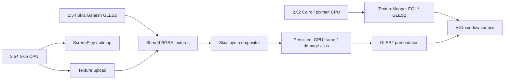

# Symbian port: 2.52.6 and 2.54.2

This compares `2.52.6-symbian` at `371f35f50d6` with the current
`2.54.2-symbian` branch. Both target ARM11 phones running Symbian^3, Anna
or Belle through a single-process WebKitLegacy browser.

## Module differences

| Module | 2.52.6 Symbian | 2.54.2 Symbian |
| --- | --- | --- |
| Page and Canvas 2D painting | Cairo CPU rasterization | Ganesh GLES2 GPU rasterization for page tiles and accelerated canvases; Skia CPU surfaces for software painting |
| CPU drawing | pixman with ARMv6 SIMD paths | Scalar Skia raster pipeline for ARMv6/VFPv2 |
| Fonts | Cairo/FreeType backend, HarfBuzz and fontconfig | Skia font backend with FreeType, HarfBuzz and fontconfig; system fonts and WOFF2 remain available |
| Composition | Native EGL/GLES2 TextureMapper | Upstream Skia layer compositor with a native WebKitLegacy bridge |
| Presentation | ScreenPlay mapped buffers, dirty regions and bitmap fallback | Same native presentation paths |
| WebGL | ANGLE over native GLES2 | Same WebGL 1 integration, with current ANGLE/WebCore interfaces |
| JavaScript | ARM LLInt, Baseline JIT and DFG | ARM11 tiers adapted to the current inline caches, register conventions, OSR and compilation interfaces |
| Allocation | Chunk-backed WTF/JSC storage and SDK runtime allocation | Same allocator design with current allocation interfaces and pointer ownership handling |
| Media | Native MMF audio/video and Web Audio PCM output | Same media services with current seek promises, playback interfaces and native DLL dependencies |
| Networking and storage | curl/mbedTLS, cookies, WebSocket, IndexedDB and browser storage | Current engine interfaces, wall-clock cookie expiry and Legacy WebSocket channel integration |
| Dependencies | Cairo, pixman and SDK JPEG | Skia and libjpeg-turbo 3.1.2; Fontconfig 2.13 and FreeType 2.9 minimum versions |
| Build and delivery | ARM SDK build, browser/ICU SIS and separate JSC shell | Skia-aware build and CI, packed static JIT objects and the same package layout |

The viewport tile cache, dirty uploads, bounded prefetch, pooled textures,
native JPEG decoding and frame-stage timing are carried forward from the
2.52 adaptation. The raster engine and its native integration are the main
graphics changes between these two Symbian branches.

Upstream 2.54 disables JIT and DFG by default on 32-bit targets. Symbian
explicitly enables its adapted ARM11 backends. The SDK's mimalloc is used
by both branches; the separate WebKit `USE_MIMALLOC` option remains off.

## Added content

- Skia drawing, image, font and filter backends, with BGRA premultiplied
  surfaces and Symbian thread-local storage integration.
- ARM32 adaptations for current Baseline/DFG inline caches, property access,
  runtime calls, linked compilation data and Map/Set iteration, with the
  shared quick DFG tier-up policy.
- A minimal bmalloc compatibility target and static archive integration for
  the current JavaScriptCore build.
- libjpeg-turbo dependency builds, Skia raster probes and focused ARM11
  JavaScript regressions.
- ARM RegExp JIT with Latin1/UTF-16 matching and DFG int32 remainder for
  positive constant powers of two.
- Generic 32-bit DFG strict equality and inequality fast paths for values and
  branches, plus guarded VFPv2 `Math.trunc` paths in the native thunk and DFG.
- Current native MMF audio linking through the SDK controller framework.
- Ganesh page and Canvas rasterization with native texture sharing, context
  synchronization and shared-resource cleanup. The GPU resource cache is
  limited to 8 MiB, glyph textures to 2 MiB, with synchronous shader work.
- Upstream Skia scene composition, image-set batching, masks, blend modes,
  filters, backdrop filters and preserve-3D ordering through the native layer bridge.
- Damage propagation for changed tiles, layer movement, removal and ordering;
  retained GPU frames preserve pixels outside the composition damage.

Shared engine defaults also enable Temporal, CSS `@function`, `if()` and
typed `attr()`, scroll anchoring, `ReadableStream.from()`, stream transfer,
IndexedDB `getAllRecords()`, CloseWatcher and Origin-Agent-Cluster semantics.
These use the shared JavaScript/WebCore implementations and the port's
existing worker, storage, DOM and rendering services.

## Reduced content

- Cairo and pixman leave the Symbian dependency and link paths, together
  with the Cairo-specific drawing and font integration.
- The pixman ARMv6 SIMD implementation is replaced by Skia's scalar CPU
  raster pipeline. GPU rasterization is a separate rendering path.

FTL, WebAssembly, WebGPU, WebRTC, Media Source Extensions and the GPU
process remain disabled in both Symbian branches. The upgrade preserves
the native browser, input, media, networking and storage capabilities.

## Optimization coverage

**Active** means the selected Symbian path uses the implementation.
**Partial** means some relevant paths are integrated. **Pending** means
the platform integration is still required.

| 2.54 mechanism | Coverage | Symbian path |
| --- | --- | --- |
| Skia CPU painting and font rendering | Active | ARMv6 scalar drawing with native system fonts |
| Ganesh GLES2 rasterization | Active | Native GLES2 contexts, BGRA surfaces and shared page-tile textures |
| Canvas picture recording and state replay | Active | Ganesh-backed Canvas 2D recording, playback and GPU image copies |
| Quick DFG tier-up | Active | Shared compilation thresholds and profile coverage policy apply to ARM11 |
| ARM RegExp JIT | Active | Native Latin1/UTF-16 matching and supported-pattern interpreter fallback |
| Integer remainder by constant powers of two | Active | ARMv6 shifts and masks in DFG |
| Generic 32-bit strict equality and inequality | Active | Tag/payload, cell identity and distinct-object fast paths in DFG value and branch forms |
| `Math.trunc` | Active | Guarded VFPv2 conversion in the native thunk and DFG, preserving signed zero and numeric edge cases |
| ARM11 JavaScript optimization | Partial | Baseline/DFG, OSR and concurrent compilation; architecture-specific 64-bit fast paths use generic ARM32 paths |
| Dirty-region painting and texture uploads | Active | Viewport tile cache, incremental uploads and ScreenPlay updates |
| Skia damage-aware composition | Active | Dirty regions repaint a retained GPU target; EGL presents the resulting frame |
| Skia layer compositor and batched image sets | Active | Upstream Skia scene and image-set helpers through the native layer bridge |
| WebKit image GPU atlas and tile DDL replay | Pending | Requires the coordinated Skia painting engine |
| Threaded tile painting | Pending | Layer rasterization runs on the browser's main thread |
| Asynchronous scrolling | Pending | Native input and smooth scrolling are active; asynchronous scrolling is disabled |
| Filter and mask optimization | Active | Skia compositor filter surfaces, path and image masks, backdrop caching and blend modes |
| Allocator improvements | Partial | Native chunk allocation and SDK mimalloc; WebKit's `USE_MIMALLOC` option is disabled |
| Process footprint and memory policy | Partial | Native RAM queries and chunk management are active; process footprint sampling requires a native implementation |
| Profile-guided optimization | Pending | Profile generation and profile-guided release builds are disabled |
| Media pipeline optimization | Partial | Native MMF playback; GTK/WPE GStreamer-specific paths and MSE remain separate integration work |

Ganesh's glyph, texture and shader caches are separate from WebKit's
coordinated image-atlas and tile DDL implementation. Symbian exposes the
upstream Skia compositor through its native layer and backing-store bridge.
`USE_COORDINATED_GRAPHICS` remains disabled; threaded painting and atlas/DDL
integration are separate work.

The GTK/WPE `UseSkiaForComposition` preference belongs to their coordinated
renderer. Symbian's compositor is selected by its native embedding.
Similarly, the GTK/WPE threaded tile architecture does not change the
single-process Symbian painting loop automatically.

## Platform boundaries

- EGL/GLES2 and Window Server surfaces provide the native GPU route.
  OpenVG and OpenWF Composition are separate APIs.
- Native MMF supplies audio/video playback. Video-frame access for Canvas
  and WebGL requires additional surface and pixel-format integration.
- New WebAssembly and 64-bit JIT optimizations require matching execution
  backends. ARM11 uses its supported JavaScript tiers and generic paths.
- Custom select controls using `appearance: base-select` remain disabled
  by the current CSS base-appearance feature default.

See the [Symbian configuration](../../../Source/cmake/OptionsSymbian.cmake),
[shared feature preferences](../../../Source/WTF/Scripts/Preferences/UnifiedWebPreferences.yaml)
and [project progress](PROGRESS.md) for the active settings and remaining work.

See [ARM11 JavaScript performance](JavaScriptPerformance.md) for measurements and next targets.
